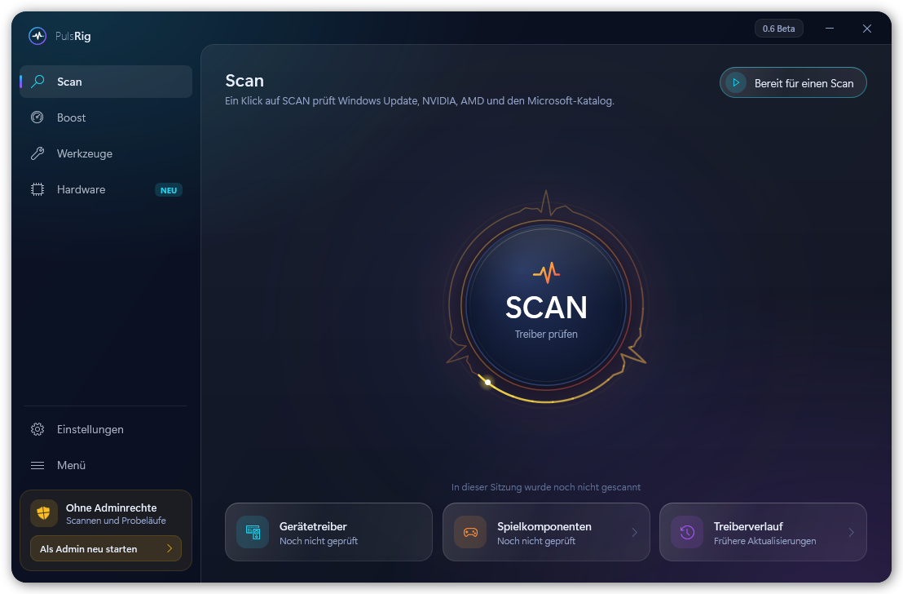
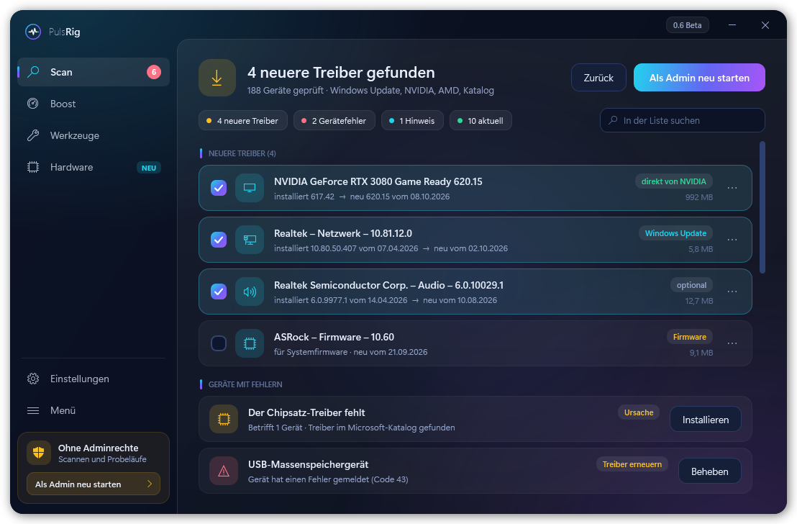
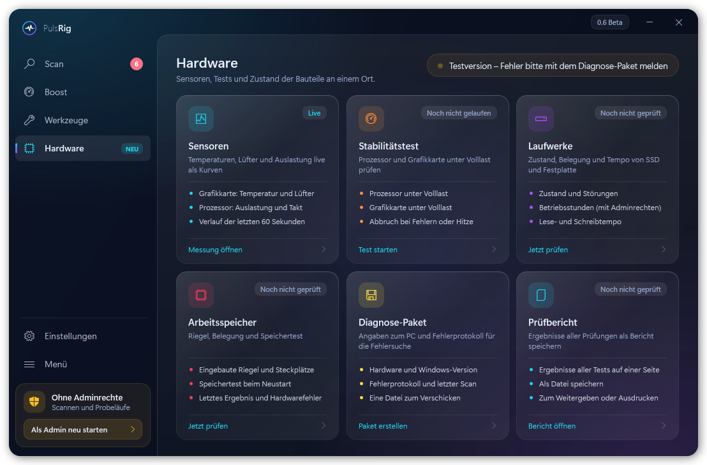

# PulsRig

Windows-Programm für Treiber, Boost und Werkzeuge: sucht neuere Treiber (Windows Update, NVIDIA, AMD, Microsoft-Katalog), schafft vor dem Spielen Platz und bringt Prüfungen für Hardware mit.

**Webseite:** https://pulsrig.github.io/PulsRig/ · **Quelltext:** [PulsRig/PulsRig-Code](https://github.com/PulsRig/PulsRig-Code) (GPL-3.0)

**Testversion.** Fehler bitte mit dem Diagnose-Paket an pulsrig.hilfe@gmail.com schicken (im Programm: Hardware → Bericht & Diagnose → „Als ZIP speichern“, danach „Per E-Mail schicken“).

| Ergebnisse eines Scans | Hardware-Seite |
| --- | --- |
|  |  |

Die Bilder zeigen Beispieldaten.

## Herunterladen

Die aktuelle Setup-Datei steht unter [Releases](../../releases/latest).

- Windows 10 oder 11, 64 Bit
- Die Datei ist nicht signiert. Windows warnt deshalb beim Start: „Weitere Informationen“ → „Trotzdem ausführen“.
- Eine ältere Fassung muss nicht entfernt werden. Das Setup spielt die neue darüber, die Einstellungen bleiben erhalten.

## Was die Datei `version.json` soll

Installierte Fassungen lesen sie beim Start einmal und vergleichen das Baudatum mit dem eigenen. Gibt es eine neuere Fassung, zeigt PulsRig das oben rechts an. Geladen oder installiert wird dabei nichts von allein; in den Einstellungen lässt sich das Nachsehen abschalten.
